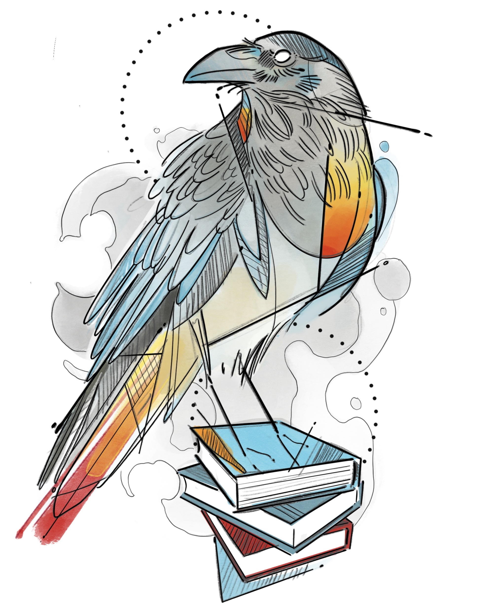

I am **Ricardo Rodrigues**, a Senior Game Developer at [iliAD]({{ site.url }}/portfolio/#iliad). I am passionate about games: playing them, and building them.

Most of my work sits where games meet artificial intelligence. I spent seven years, from 2017 to 2024, on a Ph.D. in **Affective Computing**, building game characters that feel and express emotion; you can read about [the thesis and its defense]({{ site.url }}/ph-d-thesis-and-defense/). At iliAD I work on streaming playable demos into games that are already released. Before that I worked as a Senior Unreal Engineer with [Codfish Academy]({{ site.url }}/portfolio/#codfish-academy) and as an AI engineer on [Youmio]({{ site.url }}/portfolio/#youmio). Most days that means **Unreal Engine**, **Unity** and **C++**.

## Teaching and community

Alongside the work I've taught game-related courses as a Teaching Assistant at [Técnico](https://tecnico.ulisboa.pt/), co-founded the student club [Game Dev Técnico](https://gamedev.tecnico.ulisboa.pt/), and coordinated [LabJogos Técnico](https://labjogos.tecnico.ulisboa.pt/). I also built games for research projects such as [Virtual Tutoring](https://sites.uab.pt/tutoria-virtual/) and [Festarola](https://www.researchgate.net/publication/336561569_Festarola_a_Game_for_Improving_Problem_Solving_Strategies), worked as a web developer at [t_insight](https://www.tinsight.pt/), and helped found [Sopa para Todos]({{ site.url }}/projects/2022-05-05-sopa-para-todos/), a movement against hunger.

The work itself is in the [portfolio]({{ site.url }}/portfolio/), and the full history is in my [résumé]({{ site.url }}/{{ site.resume-url }}).

## Why Colorcrow?

My nickname comes from a tattoo I have on my arm, which portrays **colorful crow on top of some books** by the artist Taylor Catclaw ([@taylorcatclaw](https://www.instagram.com/taylorcatclaw/)).
The crow has historically been related to knowledge, the link to the inevitable death of everything, and the pain associated with it. Furthermore, it is also part of the symbol of the city I was born in, Lisbon, where two crows are seen at the edges of a ship. It is also a constant presence in the tales of the unknown from authors like H.P. Lovecraft and Edgar Allan Poe (hence the books).

